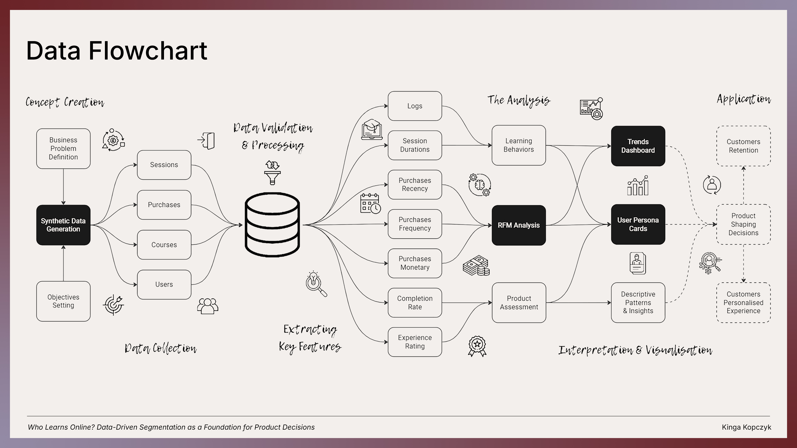
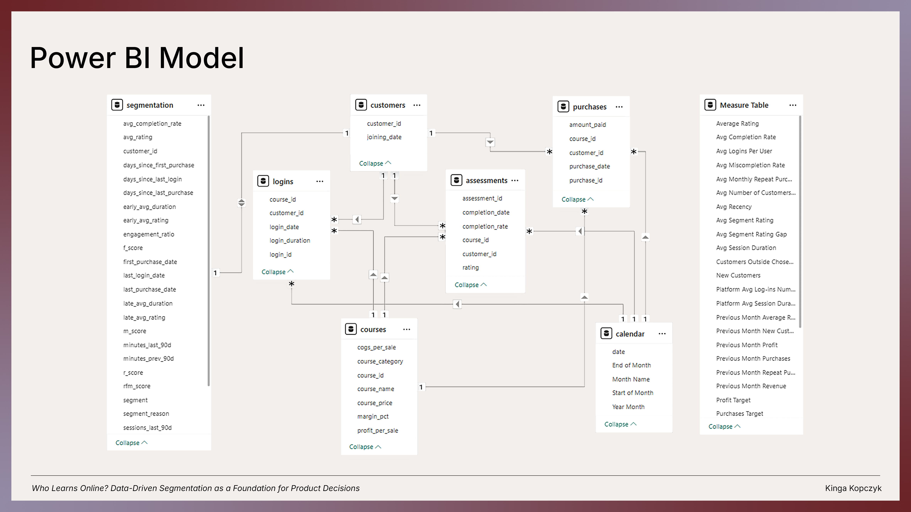
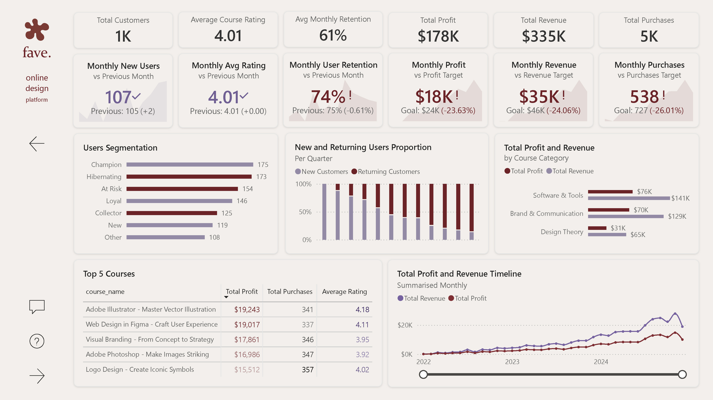
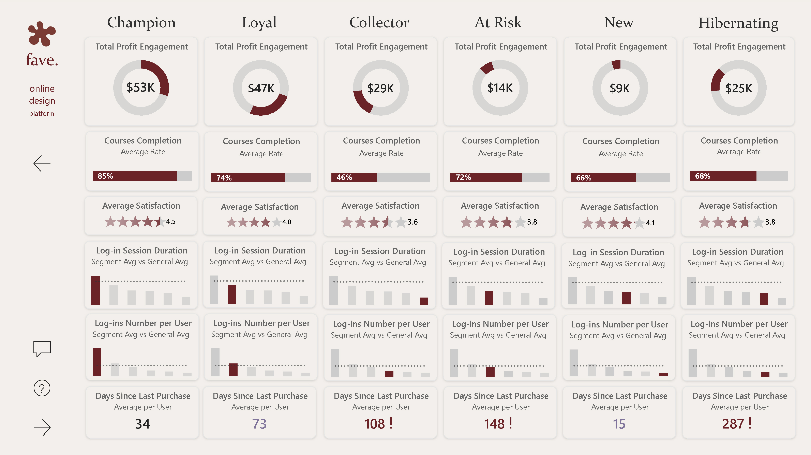
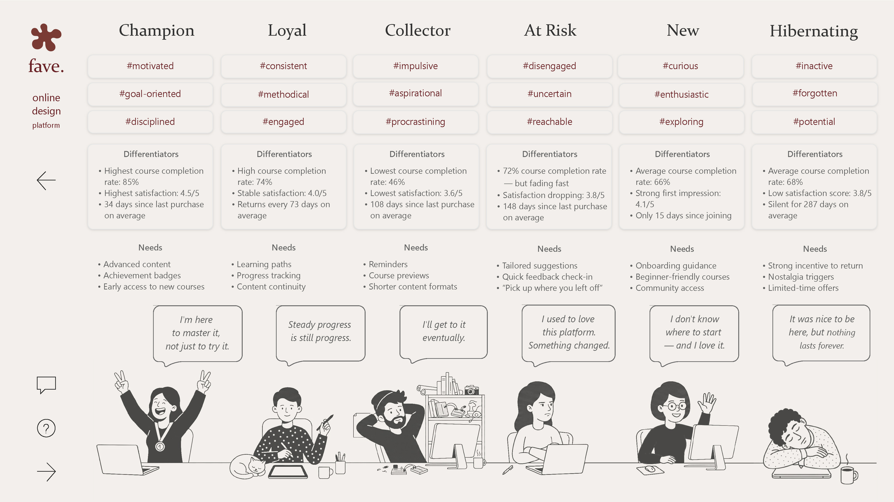
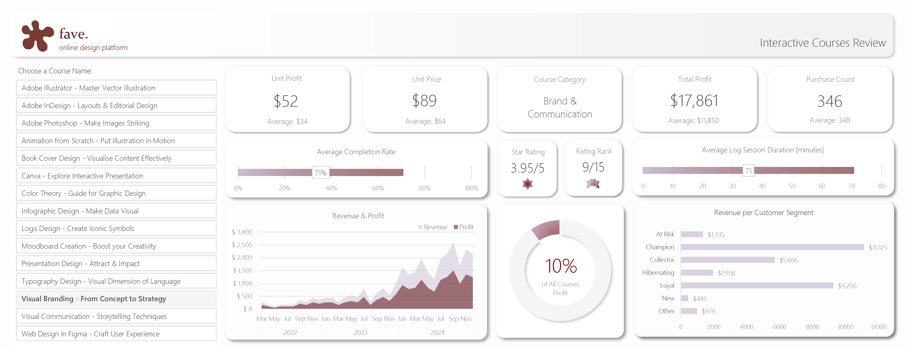
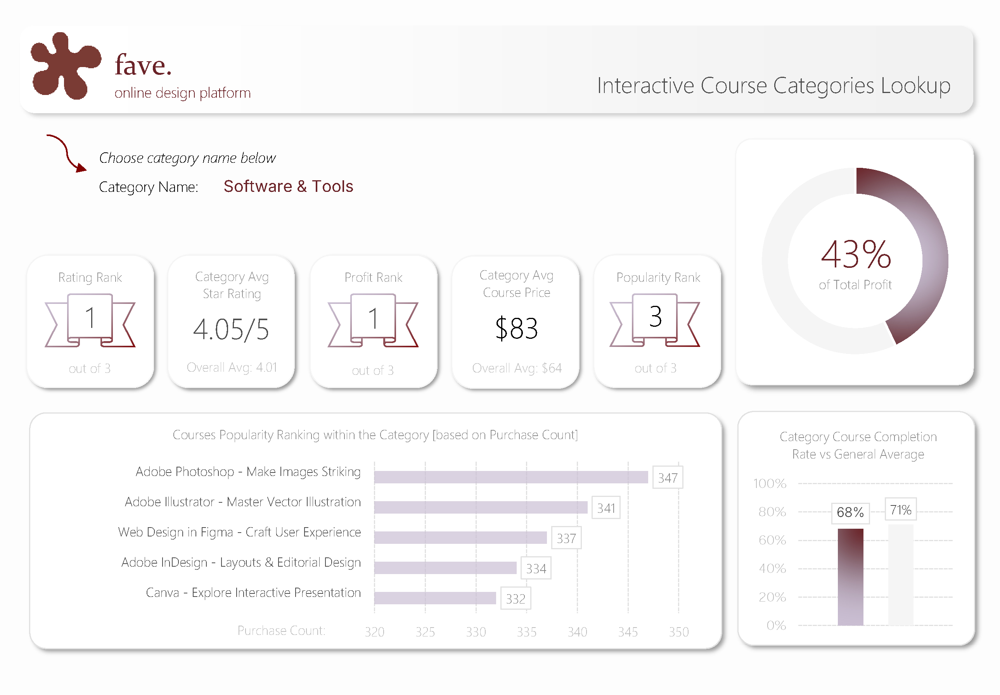

# Who Learns Online?
### Data-Driven Segmentation as a Foundation for Product Decisions

**Project 1 of 3 — Data Analytics Portfolio**

A fast-growing e-learning platform wants to know who actually drives its revenue — and where the next problem will come from. Revenue grew 2.7× in 2024, yet new sign-ups have fallen two years in a row and profit in December 2024 was 32% below November. This project segments the customers of a fictional design-focused platform called **fave.** using RFM analysis enriched with behavioral data: course completion, login activity, and satisfaction scores. The result is six actionable customer personas (plus a small residual group) and a Power BI dashboard that translates raw behavioral data into retention strategy. Two interactive Excel dashboards then extend the analysis from the customer side to the course side.



---

## Tools & Stack

| Layer | Tool |
|---|---|
| Synthetic data generation | Python · Faker |
| Database & analysis | PostgreSQL · SQL |
| Visualization | Power BI · DAX |
| Course-side reporting | Excel (Power Pivot · PivotTables · dynamic-array formulas) · VBA |
| Documentation | Markdown · GitHub |

---

## Project Structure

```
📁 customer-segmentation/
│
├── 📄 README.md
├── 📄 LICENSE
│
├── 📁 data/
│   ├── 📁 data_generator/
│   │   └── online_design_platform_data_generator.ipynb
│   ├── 📁 generated_data/
│   │   ├── customers.csv
│   │   ├── courses.csv
│   │   ├── purchases.csv
│   │   ├── assessments.csv
│   │   └── logins.csv
│   └── 📁 sql_queries_results/
│       ├── segmentation.csv            (27 columns — read by Power BI and Excel)
│       └── segments_distribution.csv
│
├── 📁 sql/
│   ├── 00_schema.sql
│   ├── 01_data_validation.sql
│   ├── 02_rfm_scoring.sql
│   ├── 03_segmentation.sql
│   ├── 04_segments_distribution.sql
│   └── 05_extra_analysis.sql
│
├── 📁 power_bi/
│   ├── Course_Platform.pbix
│   ├── Course_Platform.pdf
│   ├── Course_Platform-1.jpg
│   ├── Course_Platform-2.jpg
│   └── Course_Platform-3.jpg
│
├── 📁 excel/
│   ├── Who_learns_online.xlsx
│   ├── Who_learns_online.xlsm
│   ├── 📁 vba/
│   │   └── refresh_and_export_to_pdf.bas
│   ├── courses_dashboard_<date>.pdf          (PDF exports created by the macro)
│   ├── categories_mini_dashboard_<date>.pdf
│   ├── excel_courses_dashboard.jpg
│   └── excel_categories_dashboard.jpg
│
├── 📁 diagrams/
│   ├── who_learns_online_flowchart.jpg
│   └── powerbi_model_architecture.jpg
│
└── 📁 graphics/
    ├── course_platform_logo.png
    └── persona_illustration.jpg
```

---

## Business Problem

fave. is growing fast: revenue rose from $24K (2022) to $85K (2023) and $226K (2024). Underneath that growth sit three signals worth a closer look:

- **Growth leans on existing customers while acquisition shrinks.** New sign-ups (customers by joining date) fell from 409 (2022) to 357 (2023) to 234 (2024), and 50.7% of all 2024 purchases already came from customers who had first bought before 2024.
- **Value sits with repeat buyers.** 92% of customers bought at least twice; customers with three or more purchases are 81% of the base and generate 94% of profit. A decline in their activity would hurt — and would not show in a platform-wide average.
- **The latest month dipped.** Profit in December 2024 was 32% below November (still 61% above December 2023, so a dip inside growth rather than a collapse — but with three years of data, seasonality cannot be ruled out).

Course ratings are stable at the platform level (4.0 on average; 30% of purchases carry no rating), so the signals above do not look like a content-quality problem. This analysis therefore looks at user behavior: **who** buys and keeps learning, **who** is slipping away, and **what** the platform should do differently for each group.

**Analytical objectives:**
1. Explore current sales trends and platform-level KPIs
2. Verify changes in user behavior through login and session data
3. Segment users based on purchase history, course completion, login activity, and ratings
4. Diagnose where value is concentrated and where it is at risk, through segment size, profit, and behavioral signals
5. Propose data-driven product decisions for each customer segment

---

## Data

Synthetic data was generated using Python and the **Faker** library. The dataset simulates three years of platform activity (2022–2024) across five relational tables.

### Schema

```
customers     customer_id · joining_date
courses       course_id · course_name · course_category · course_price · margin_pct · profit_per_sale · cogs_per_sale
purchases     purchase_id · customer_id · course_id · purchase_date · amount_paid
assessments   assessment_id · customer_id · course_id · completion_rate · rating · completion_date
logins        login_id · customer_id · course_id · login_date · login_duration
```

A customer buys a given course at most once, so `(customer_id, course_id)` is unique in `purchases`; every assessment and login row refers to that pair.

### Course Catalogue

15 design courses across three categories:

| Category | Courses |
|---|---|
| Software & Tools | Adobe Illustrator, Adobe Photoshop, Adobe InDesign, Web Design in Figma, Canva |
| Design Theory | Animation from Scratch, Color Theory, Moodboard Creation, Book Cover Design, Typography Design |
| Brand & Communication | Logo Design, Presentation Design, Infographic Design, Visual Communication, Visual Branding |

### Behavioral Profiles

Each synthetic customer was given characteristics of a behavioral profile during generation. These profiles drove realistic variation in purchase frequency, completion rates, session duration, and ratings, to strengthen the diversity of the segments recovered in the RFM analysis.

> **Note:** The profile information used during generation is not included in the final CSV files. It was not exported as a part of generated data.

### Key Data Facts

| Metric | Value |
|---|---|
| Customers | 1,000 |
| Courses | 15 |
| Purchases | 5,217 |
| Login sessions | 51,609 |
| Assessment records | 5,217 (one per purchase; 3,640 carry a rating, 69.8%) |
| Date range | Jan 2022 – Dec 2024 |

**Data quality notes.** Ratings are optional (30.2% missing) and a completion date exists for 55.7% of assessments — both nullable by design. Completion dates and login sessions were generated independently, so 230 of 2,904 completion dates (7.9%) fall before the first login of that course. The segmentation uses completion rates and login counts and durations — not these dates — so it is unaffected.

---

## SQL Analysis

All analysis was performed in **PostgreSQL**. Queries are organized into six files reflecting the analytical workflow (00–04 build and analyse the segmentation, 05 adds four stand-alone analyses). The business logic lives in views (`v_params` → `v_rfm` → `v_behavior` → `v_customer_segments`), so every output — the CSV exports, Power BI, Excel — reads from one source of truth and the segment rules exist in exactly one place.

### 00 — Schema

- Five tables with primary and foreign keys and `CHECK` constraints (rating 1–5, completion rate 0–1, positive prices and durations). `(customer_id, course_id)` is unique in `purchases`, which guarantees that every assessment and login belongs to a real purchase.
- `v_params` holds the **snapshot date (2024-12-31)** — the last day covered by the data. Every "days since" measure uses it instead of `CURRENT_DATE`, so results are identical whenever the queries are run.

### 01 — Data Validation

Verifies referential integrity and data quality before analysis:
- **Row counts** of the five tables (1.0): a table with 0 rows is flagged as `EMPTY`, because every integrity check passes vacuously on an empty table.
- **23 integrity checks** in a single summary table — date consistency (no login before joining date, no completion before purchase), referential integrity (no orphaned assessment or login), uniqueness, value ranges, and NULLs in mandatory fields. All 23 return 0 violations.
- NULL audit of the fields that are nullable by design (rating, completion date).
- One documented limitation: completion dates that precede the first login (7.9%, see *Data*).
- Per-course completion and rating, customer joining distribution, and course popularity ranking.

### 02 — RFM Scoring

Calculates Recency, Frequency, and Monetary scores (1–5) for each customer using fixed, documented thresholds:

| Score | Recency — days since last purchase | Frequency — purchases | Monetary — total spent |
|---|---|---|---|
| 5 | ≤ 30 | 8 or more | $500 or more |
| 4 | 31–90 | 5–7 | $350–499 |
| 3 | 91–180 | 3–4 | $250–349 |
| 2 | 181–365 | 2 | $150–249 |
| 1 | > 365 | 1 | below $150 |

- **Recency** thresholds follow business time periods (a month, a quarter, half a year, a year); **Frequency** follows business meaning (one-off buyer, second purchase, repeat buyer, frequent buyer, heavy buyer); **Monetary** uses near-quintile cut-offs rounded to $50.
- **Why not NTILE?** `NTILE(5)` cuts customers into equal-sized groups and therefore splits tied customers *arbitrarily*: scoring Frequency with it would spread customers with 3, 4, 6 or 8 purchases — 445 customers, 44.5% — over two different scores each, depending on physical row order. Fixed thresholds guarantee that identical customers receive identical scores (check 2.4 returns 0 conflicts), make every later rule readable ("3+ purchases"), and make the analysis reproducible. Query 2.5 reproduces the NTILE problem.
- Following Hughes (1994), equal weight is assigned to all three dimensions (`rfm_score` = R + F + M, range 3–15).

### 03 — Behavioral Enrichment & Segmentation

Standard RFM does not capture post-purchase behavior. The view `v_behavior` enriches each customer with:

- **avg_completion_rate** — average course completion per customer
- **avg_rating** — average satisfaction score (unrated courses are ignored)
- **engagement_ratio** — the customer's average session duration relative to the average for the *same course* (above 1.0 = longer than average; the course-level benchmark accounts for natural differences in course format and complexity)
- **login activity** — sessions and minutes in the last 90 days versus the previous 90 days, and days since the last login: the basis for detecting fading usage
- **session_trend / rating_trend** — early vs. late halves of the customer's history. Kept as descriptive columns but deliberately *not* used as rules: with only a handful of ratings per customer they are mostly noise.

> *"Segments are assigned based on RFM scores enriched with behavioral data — completion rate and session activity — to differentiate customers who buy but do not engage from those who actively learn."*

The view `v_customer_segments` assigns exactly one segment per customer with an ordered rule list — **the first matching rule wins** — and stores a plain-language reason for every customer in `segment_reason`:

| # | Segment | Rule |
|---|---|---|
| 1 | New | first purchase ≤ 90 days ago **and** at most 2 purchases |
| 2 | Hibernating | no purchase for > 180 days **and** no login for > 90 days |
| 3 | Champion | last purchase ≤ 90 days ago, 5+ purchases, completion ≥ 75%, engagement ≥ 1.0 |
| 4 | Collector | 3+ purchases, completion < 55% |
| 5 | At Risk | 3+ purchases **and** fading usage: logins or login time in the last 90 days ≤ 50% of the previous 90 days, or no login for > 30 days |
| 6 | Loyal | 3+ purchases, completion ≥ 55%, last purchase ≤ 180 days ago |
| 7 | Other | the remainder — see *Why do customers land in "Other"?* below |

Design choices:
- "Repeat buyer" means 3+ purchases.
- Hibernating requires silence on **both** fronts — purchases and logins — so a learner who still logs in is never labeled "forgotten".
- At Risk is driven by fading **login activity**, not by purchase recency alone: a customer who has not bought for a while but still logs in regularly is still learning, and a recency-only rule would label that customer a churn risk.
- All thresholds are judgement calls. They are documented in one place, and query 4.5 tests how much the At Risk group depends on them.
- Every query after 03 (and the CSV export) reads the view, so nothing repeats the segment rules.

**Methodology references:** Hughes, A.M. (1994). *Strategic Database Marketing*. Probus Publishing — RFM scoring. / Fader, P.S., Hardie, B.G.S., & Lee, K.L. (2005). *"Counting Your Customers" the Easy Way.* Marketing Science, 24(2), 275–284 — a probabilistic (BG/NBD) alternative to score-based segmentation; not used here, but a natural next step.

### 04 — Segment Distribution & Diagnostics

- Segment sizes, behavioral profiles, and profit per segment (profit = amount paid − cost of goods sold).
- Why customers are At Risk (which signal triggered the label; signals overlap) and why they are in Other.
- A sensitivity grid for the At Risk thresholds.
- Five integrity checks: every customer has exactly one valid segment, no duplicates, no unmatched rule.

### 05 — Additional Analyses

Four stand-alone queries that practise window functions and cohort logic on the same database; they do not feed the dashboards. Every block in `05_extra_analysis.sql` states the business question, how the query works, the result and its limits.

- **5.1 Month-over-month revenue** (`LAG`, `NULLIF`, `COALESCE`): revenue rose in 24 of the 35 month-to-month comparisons. Dec 2024 is the largest fall (−$8,973, −32%) after the record Nov 2024, but is still +61% year over year.
- **5.2 Top 3 customers per segment** (`ROW_NUMBER` vs `RANK`): ties are common, because a customer's total is a sum of at most 15 fixed course prices. `RANK` returns four customers in Collector and Hibernating where `ROW_NUMBER` would silently drop one.
- **5.3 Cumulative profit and 3-month moving average** (window frames): 2024 produced 67.5% of the $177,753 lifetime profit, which matches the dashboard total. The moving average fell in only two months of the series; Dec 2024 is the only notable break.
- **5.4 Cohort retention** (CTEs, date arithmetic, `FILTER`): pooled over the 2022–23 cohorts, 76–84% of customers log in during each of months 1–5 and 70% in month 6. The higher 2024 figures partly reflect more repeat buyers, and every login in this synthetic dataset falls within 180 days of its purchase, so the month-6 drop is a property of the data, not a churn signal.

---

## Segmentation Results

### Segment size and value

| Segment | Customers | Share | Profit | Share of profit | Profit per customer |
|---|---|---|---|---|---|
| Loyal | 338 | 33.8% | $59.8K | 33.7% | $177 |
| Champion | 213 | 21.3% | $59.9K | 33.7% | $281 |
| Hibernating | 157 | 15.7% | $12.4K | 7.0% | $79 |
| Collector | 152 | 15.2% | $32.5K | 18.3% | $214 |
| At Risk | 54 | 5.4% | $8.4K | 4.7% | $155 |
| New | 46 | 4.6% | $1.8K | 1.0% | $40 |
| Other | 40 | 4.0% | $2.9K | 1.6% | $72 |
| **Total** | **1,000** | **100%** | **$177.8K** | **100%** | **$178** |

### Behavioral profile

| Segment | Purchases | Days between purchases¹ | Last purchase (days ago) | Last login (days ago) | Completion | Rating | Engagement ratio | Sessions last / previous 90 days | Logged in within 30 days |
|---|---|---|---|---|---|---|---|---|---|
| Loyal | 5.2 | 113 | 69 | 4 | 73% | 3.93 | 0.78 | 21.3 / 7.7 | 100% |
| Champion | 8.2 | 69 | 36 | 1 | 85% | 4.44 | 1.22 | 56.7 / 18.0 | 100% |
| Hibernating | 2.3 | 139 | 431 | 283 | 67% | 3.64 | 0.36 | 0.0 / 1.5 | 0% |
| Collector | 6.3 | 93 | 103 | 17 | 45% | 3.60 | 0.36 | 9.1 / 5.0 | 81% |
| At Risk | 4.7 | 114 | 180 | 49 | 70% | 3.72 | 0.45 | 3.1 / 7.8 | 24% |
| New | 1.2 | 32 | 15 | 2 | 64% | 4.20 | 0.50 | 7.6 / 0.0 | 100% |
| Other | 2.0 | 276 | 114 | 20 | 66% | 3.89 | 0.51 | 4.6 / 3.8 | 75% |

¹ Averaged over customers with at least two purchases (for New: 11 customers).

### Segment Definitions

**Champion** — Recent, frequent buyer (8.2 purchases on average, last purchase 36 days ago) who completes most courses (85%) and has sessions longer than the course average (engagement ratio 1.22). Highest satisfaction score: 4.4/5. 21.3% of customers, 33.7% of profit, $281 profit per customer.

**Loyal** — Regular, steady learner: 5.2 purchases on average, one roughly every 113 days, a solid completion rate of 73%, and satisfaction of 3.9/5. Everyone in this segment has logged in within the last 30 days. The largest segment (33.8%) and, together with Champions, two-thirds of all profit.

**Collector** — Repeat buyer (6.3 purchases) with completion below 55% (45% on average). Buys more than it learns: sessions are only 36% as long as the course average, and satisfaction of 3.6/5 is the lowest of all segments. Still valuable — 18.3% of profit — and 81% logged in during the last 30 days.

**At Risk** — Repeat buyer (4.7 purchases) whose login activity is fading: sessions per 90 days fell from 7.8 to 3.1 on average, and only 24% logged in during the last 30 days (41 of 54 have been silent for more than 30 days). Small — 5.4% of customers, 4.7% of profit — but identifiable early, before the customer turns into Hibernating.

**New** — First purchase within the last 90 days (23 days ago on average) and at most two purchases in total (35 customers with one, 11 with two). Above-average satisfaction (4.2/5) and 64% completion: a positive first impression that needs to be reinforced. Fast starters are not in this group: 29 of the 75 customers who made their first purchase in the last 90 days already have 3+ purchases and are classified by their behavior (16 Loyal, 12 Champion, 1 Collector).

**Hibernating** — No purchase for more than 180 days (431 on average) and no login for more than 90 days (283 on average). Averaged only 2.3 purchases. 15.7% of customers but 7.0% of profit ($12.4K): worth a low-cost win-back, not a large investment.

**Other** — The residual group the rules deliberately do not label (4.0%): exactly two purchases, a first purchase more than 90 days ago, and still active. See below.

### Why do customers land in "Other"?

"Other" is not a data-quality bucket — the reason is stored for every customer in `segment_reason`.

All 40 have exactly two purchases, bought their first course more than 90 days ago, and are still active (every one logged in within the last 90 days, so none is hibernating). They are one purchase short of repeat-buyer status and buy slowly — 276 days between their two purchases, against 113 for Loyal customers — so there is too little history to tell a growing customer from a drifting one. 16 bought their second course within the last 30 days, 12 between 91 and 180 days ago, and 12 more than 180 days ago.

The group is the result of an explicit rule, not of a gap in the rules: integrity check 4.6 confirms that no customer lands in "Other" because no rule matched.


---

## Key Insights

Segment definitions use completion and engagement, so differences in those two columns are partly by construction. The insights below therefore rest on what the rules do *not* decide: profit, purchase cadence, login activity, and ratings.

**1. Two segments carry two-thirds of the profit.**
Champion (21.3% of customers) and Loyal (33.8%) together generate 67.4% of profit. A Champion is worth $281 in profit, a Loyal customer $177, and a Hibernating customer $79. Champions also return more often — every 69 days on average, against 113 for Loyal customers — so moving Loyal customers toward Champion behavior is the most valuable upgrade path.

**2. Collectors buy more than they learn — and still pay.**
15.2% of customers and 18.3% of profit ($214 per customer), but only 45% completion, sessions at 36% of the course average, and the lowest satisfaction (3.60). Profitable today, yet a customer who buys without finishing may stop buying. Shorter content formats and progress nudges before the next upsell are the natural lever.

**3. At Risk is small and actionable — and login activity is the early warning, not purchases.**
54 customers (5.4%) with 4.7 purchases each, whose sessions fell from 7.8 to 3.1 per 90 days. Their $8.4K profit (4.7% of the total) is at stake. Across the thresholds tested (a 40–75% decline in logins, 21–60 days of silence) the group stays between 39 and 83 customers (3.9–8.3%): small under any reasonable definition, so a targeted re-engagement campaign is cheap.

**4. Hibernating is the largest "lost" group by headcount, but a minor share of profit.**
157 customers (15.7%) generate 7.0% of profit and have averaged just 2.3 purchases. Reactivating them matters less in dollars than protecting Champion and Loyal customers and turning the 86 New and Other customers into repeat buyers with a third purchase.

**5. Growth depends on existing customers while acquisition shrinks.**
50.7% of 2024 purchases came from customers whose first purchase was before 2024, while yearly sign-ups (by joining date) fell from 409 to 357 to 234. The retained base is the growth engine; the acquisition funnel is the open question (this dataset holds no marketing data to explain it).

**6. The 4.0 average rating hides a gap between segments.**
Champions rate courses 4.44, Collectors 3.60, and Hibernating customers 3.64 — a gap of about 0.8 points, and ratings track engagement. Caveat: 30% of purchases carry no rating, so segment averages rest on fewer observations than segment sizes suggest.

### Suggested actions

| Segment | Suggested action |
|---|---|
| Champion | Protect and reward: early access to new courses, advanced learning paths, referral program |
| Loyal | Move toward Champion: bundles and learning paths that raise completion and shorten the time between purchases |
| Collector | Convert buyers into learners: shorter formats, progress reminders, "finish what you bought" prompts before the next offer |
| At Risk | Re-engage early: trigger a personal reminder with the next unfinished lesson when logins drop |
| New | Guide to the second and third purchase: course recommendations based on the first course |
| Hibernating | Low-cost, automated win-back; avoid heavy investment (7.0% of profit) |
| Other | Nudge toward the third purchase: recommendations built on the two courses already bought |

---

## Limitations & Next Steps

- **Synthetic data.** Customers were generated from behavioral profiles, so clear separation between groups is expected; real data would be noisier. Differences in completion and engagement between segments are partly by construction (see *Key Insights*).
- **Thresholds are judgement calls.** Cut-offs for scores and rules are documented and centralized; the sensitivity grid (query 4.5) shows how the At Risk group responds (39–83 customers across the grid, 54 at the chosen setting).
- **Missing ratings.** 30.2% of purchases have no rating; segment ratings average the rated purchases only.
- **Fixed snapshot date.** All "days since" measures refer to 2024-12-31 (view `v_params`), never to the day the query is run.
- **Three years of data.** Seasonality — for example whether December is typically weaker — cannot be established.
- **Possible next steps:** a cohort analysis of repeat purchases (query 5.4 measures login activity, which in this dataset stops 180 days after a purchase); a probabilistic model of expected purchases (BG/NBD, Fader et al., 2005); validating the recovered segments against the hidden generation profiles (confusion matrix).

---

## Power BI Dashboards

The `.pbix` file contains three dashboard pages and reads the 27-column `segmentation.csv` produced by the SQL analysis.



### Page 1 — Executive Overview

Platform-level KPIs; monthly KPI tiles (new customers, average rating, returning-buyer share, profit, revenue, purchases) compared with the previous month and — for the financial KPIs — with a target set at 110% of the previous month; a date slicer that chooses which month the tiles show (by default the latest, December 2024); new vs. returning user proportion per month; top 5 courses by profit and rating; and profit breakdown by course category and over time. The monthly rating is the average rating of the courses *purchased* in that month, because a rating carries no date of its own.



### Page 2 — Customer Segments

Per-segment metrics for the six personas (the small residual group "Other" is not shown): profit and its share of the platform total (donut), number of customers compared with the average segment size (excluding "Other"), average satisfaction (star rating), average course completion, log-in session duration compared with the platform average, and days since last purchase, flagged when it exceeds a target.



### Page 3 — Persona Cards

Six illustrated personas with behavioral keywords, differentiators, needs, and a defining quote. Personas are grounded in segmentation data and designed to inform product and retention decisions.



### DAX Measures

Key measures used across dashboards:

```dax
Total Revenue                 = SUM(purchases[amount_paid])
Total Cost                    = SUMX(purchases, RELATED(courses[cogs_per_sale]))
Total Profit                  = [Total Revenue] - [Total Cost]
Profit Margin %               = DIVIDE([Total Profit], [Total Revenue])
Previous Month Revenue        = CALCULATE([Total Revenue], DATEADD('calendar'[date], -1, MONTH))
Previous Month Profit         = CALCULATE([Total Profit], DATEADD('calendar'[date], -1, MONTH))
Previous Month Purchases      = CALCULATE([Total Purchases], DATEADD('calendar'[date], -1, MONTH))
Previous Month Average Rating = CALCULATE([Average Rating], DATEADD('calendar'[date], -1, MONTH))
Previous Month New Customers  = CALCULATE([New Customers], DATEADD('calendar'[date], -1, MONTH))
Average Rating                = AVERAGE(purchases[rating])
Avg Completion Rate           = AVERAGE(segmentation[avg_completion_rate])
Avg Miscompletion Rate        = 1 - AVERAGE(segmentation[avg_completion_rate])
Avg Recency                   = AVERAGE(segmentation[days_since_last_purchase])
Avg Segment Rating            = AVERAGE(segmentation[avg_rating])
Avg Segment Rating Gap        = 5 - AVERAGE(segmentation[avg_rating])
Avg Session Duration          = DIVIDE(SUM(logins[login_duration]), DISTINCTCOUNT(logins[login_id]))
Repeat Purchase Rate %        = DIVIDE([Returning Customers], ([Returning Customers] + [New Customers]))
Profit Target                 = [Previous Month Profit] * 1.1
Purchases Target              = [Previous Month Purchases] * 1.1
Revenue Target                = [Previous Month Revenue] * 1.1

-- Calculated column on purchases: carries the rating onto the purchase row, so ratings
-- can be analysed by purchase month (assessments has no relationship with the calendar).
rating = 
LOOKUPVALUE(
    assessments[rating],
    assessments[customer_id], purchases[customer_id],
    assessments[course_id],   purchases[course_id]
)

-- Share of a month's buyers whose first purchase was in an earlier month
-- (Repeat Purchase Rate % above); the monthly average below skips months without returning buyers.

New Customers = 
VAR VisibleDates = VALUES('calendar'[date])
RETURN
    COUNTROWS(
        FILTER(
            VALUES(customers[customer_id]),
            VAR FirstPurchase =
                CALCULATE(
                    MIN(purchases[purchase_date]),
                    ALL('calendar')
                )
            RETURN
                NOT ISBLANK(FirstPurchase)
                    && FirstPurchase IN VisibleDates
        )
    )

Avg Monthly Repeat Purchase Rate % = 
AVERAGEX(
    VALUES('calendar'[Year Month]),
    [Repeat Purchase Rate %]
)

Previous Month Repeat Purchase Rate % = 
CALCULATE([Repeat Purchase Rate %], DATEADD('calendar'[date], -1, MONTH))

-- Average segment size across the six personas shown on page 2; the residual "Other" group is excluded.
Avg Number of Customers per Segment = 
AVERAGEX(
    FILTER(ALL(segmentation[segment]), segmentation[segment] <> "Other"),
    [Total Customers]
)

Platform Avg Session Duration = 
CALCULATE(
    DIVIDE(SUM(logins[login_duration]), DISTINCTCOUNT(logins[login_id])),
    REMOVEFILTERS(segmentation[segment])
)

Platform Avg Log-ins Number per User = 
CALCULATE(
    DIVIDE(COUNTROWS(logins), DISTINCTCOUNT(logins[customer_id])), 
    REMOVEFILTERS(segmentation[segment])
)

Returning Customers = 
VAR VisibleDates = VALUES('calendar'[date])
RETURN
    COUNTROWS(
        FILTER(
            VALUES(customers[customer_id]),
            VAR FirstPurchase =
                CALCULATE (
                    MIN(purchases[purchase_date]),
                    ALL('calendar')
                )
            VAR PurchasesInPeriod =
                CALCULATE (COUNTROWS(purchases))
            RETURN
                PurchasesInPeriod > 0
                    && NOT(FirstPurchase IN VisibleDates)
        )
    )

```

---

## Excel Dashboards

The Power BI report looks at the platform from the **customer** side. The Excel workbook looks at it from the **course** side: a lightweight, portable report for someone without access to Power BI — for example, a course owner checking how a single course or category performs. It deliberately does not repeat the Power BI pages.

The workbook loads `courses`, `purchases`, `assessments`, `logins` and the SQL output `segmentation` into the Excel Data Model (Power Pivot), related through `course_id` and `customer_id`.

### Dashboard 1 — Course Dashboard (slicer-driven)

One slicer on course name drives every card and chart:
- unit price and unit profit vs. the platform average
- total profit, purchase count and the course's share of total company profit (donut chart)
- average completion rate, star rating with rank among the 15 courses, and average log session duration
- monthly revenue and profit trend, and revenue by customer segment (segments from the SQL analysis)

KPI cards are text boxes linked to cells; the charts are PivotCharts connected to the same slicer.



### Dashboard 2 — Category Lookup (dropdown-driven)

A dropdown (data validation) selects one of the three course categories. The sheet runs on dynamic-array formulas (`FILTER`, `SORT`, `UNIQUE`, `XLOOKUP`, `XMATCH`, `AVERAGEIF`, `SUMIF`, `RANK.EQ`):
- the category's rating, profit and popularity rank (out of 3)
- average star rating and average course price vs. the platform average
- the category's share of total profit, and completion rate vs. the general average
- ranking of the category's courses by purchase count



The two dashboards intentionally use two different filtering mechanisms — a slicer connected to PivotTables, and a dropdown feeding formulas — each suited to its own task.

### Technical Notes

- **Profit is aggregated at transaction level.** Profit per sale (course price − cogs per sale) is attached to every row of `purchases` with `XLOOKUP`, so total profit scales with the number of sales. Summing profit per sale directly on the `courses` table would return the per-unit value, not total profit. `course_category` is added to `purchases` and `assessments` in the same way, to allow filtering by category.
- **Share of profit uses the company-wide total** as the denominator, independent of the slicer selection — otherwise a single selected course would always show 100%.
- **Requirements:** desktop Excel (Microsoft 365 or 2021 and newer) for the dynamic arrays and the Data Model.

### VBA Automation

A short macro (`excel/vba/refresh_and_export_to_pdf.bas`), assigned to a button on the dashboard, refreshes the workbook and exports both dashboards to PDF. The macro-enabled copy is `Who_learns_online.xlsm`; the `.xlsx` version contains no macros.

---

## How to Run

### 1. Generate synthetic data

Open `data/data_generator/online_design_platform_data_generator.ipynb` in Google Colab.
Run all cells — CSV files will be downloaded automatically.

### 2. Set up the database

Create an empty PostgreSQL database and run `sql/00_schema.sql`: it creates the five tables with their constraints and the `v_params` view. Then load the five CSV files in this order (foreign keys), either with pgAdmin (*Import/Export Data*) or with `psql` from the repository root:

```
\copy customers   FROM 'data/generated_data/customers.csv'   CSV HEADER
\copy courses     FROM 'data/generated_data/courses.csv'     CSV HEADER
\copy purchases   FROM 'data/generated_data/purchases.csv'   CSV HEADER
\copy assessments FROM 'data/generated_data/assessments.csv' CSV HEADER
\copy logins      FROM 'data/generated_data/logins.csv'      CSV HEADER
```

Expected row counts: 1,000 customers · 15 courses · 5,217 purchases · 5,217 assessments · 51,609 logins.

### 3. Run SQL analysis

Open the `sql/` folder in VS Code with the SQLTools extension connected to your PostgreSQL database.
Run files in order: `01` → `02` → `03` → `04` (each file's header says whether to run it at once or query by query). `02` and `03` create the views; `04` and the exports read them. `05` is optional: four stand-alone analyses that need the loaded data and, for query 5.2, the view `v_customer_segments` from `03`; nothing else depends on it.

### 4. Export the results

Section 3.4 of `03_segmentation.sql` and query 4.1 of `04_segments_distribution.sql` contain the export queries for the files in `data/sql_queries_results/`. Export `segmentation.csv` with all 27 columns and a header row: both the Excel workbook and the Power BI report read it as a 27-column file, so refresh both after a new export.

### 5. Explore the dashboard

Open `power_bi/Course_Platform.pbix` in Power BI Desktop.
The file uses a local data connection — you may need to update the data source path to point to your local CSV files.

### 6. Explore the Excel dashboards

Open `excel/Who_learns_online.xlsx` in desktop Excel (Microsoft 365 or 2021 and newer). Pick a course in the slicer on the course dashboard sheet and a category from the dropdown on the category lookup sheet. To use the export button, open the `.xlsm` copy and enable macros. The workbook's Power Query steps point to the CSV files with a local path; on another computer, change it in the *Source* step (*Data → Queries & Connections → Edit*).

---

## About

This project is part of a three-project data analytics portfolio built to demonstrate end-to-end analytical thinking — from data design and SQL analysis to business storytelling and visualization.

The other two projects in the portfolio:
- *From Distance to Trust* — NLP & Sentiment Analysis of chatbot user interactions (Python)
- *Location Intelligence* — Spatial Scoring Model for Real Estate Investment Decisions (Python · GIS · ARIMA) — |IN PROGRESS|

---

*Synthetic data. All platform names, figures, and personas are fictional and created for analytical purposes only.*
